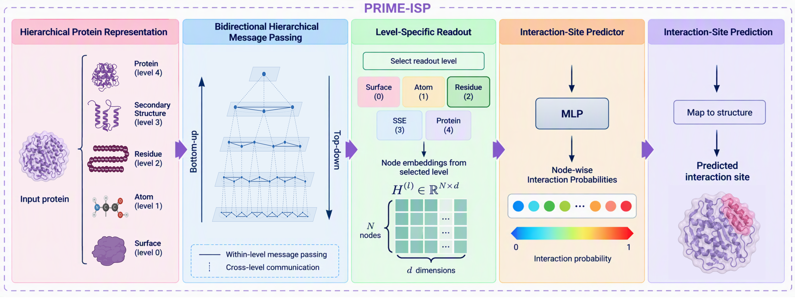

# Towards a Unified Framework for Protein Interaction Site Prediction Using Hierarchical Protein Representations

[](LICENSE)

PRIME-ISP is a structure-based interaction-site predictor that represents each protein as a five-level hierarchical graph (surface, atom, residue, secondary structure, protein) and passes messages both bottom-up and top-down across levels. The same architecture, input features, and training procedure are applied to every interaction class: protein, peptide, nucleic acid (DNA and RNA), small molecule, metal ion, and carbohydrate. A separate model instance is trained for each class (weights are not shared across classes).



## Installation

```bash
git clone https://github.com/HySonLab/PRIME-ISP.git
cd PRIME-ISP

conda create -n prime-isp python=3.10 -y
conda activate prime-isp

pip install -r requirements.txt \
    --extra-index-url https://download.pytorch.org/whl/cu118 \
    -f https://data.pyg.org/whl/torch-2.3.0+cu118.html
```

## Data Preparation

All benchmark sequences, labels, and split files are in this repository under `Datasets/`. The predicted structures (ESMFold2) and the trained model checkpoints are archived on Zenodo: https://doi.org/10.5281/zenodo.23198572

Download the archive and extract it so that predicted PDB files sit at `Datasets/<TASK>/PDBs/` and checkpoints at `ckpts/`. If you want to regenerate the structures yourself, set `TASK` in `utils/folding.sh` and run it.

Next, build the hierarchical graphs from the predicted structures. Open `hierarchical_graph.sh`, set `TASK` to the benchmark family you want to prepare (`PPI-site`, `PepPI-site`, `DPI-site`, `RPI-site`, `MPI-site`, `CarbPI-site`, or `SMPI-site`), then run:

```bash
bash hierarchical_graph.sh
```

The graphs for each task are written to `Datasets/<TASK>/Graphs/`. Repeat this step for every task you plan to train or evaluate.

Expected layout:

```
PRIME-ISP/
├── config/
│   ├── data_config.yaml        # task -> split files, graph directory
│   └── model_config.yaml       # architecture hyperparameters
├── Datasets/
│   └── <TASK>/                 # PPI-site, PepPI-site, DPI-site, RPI-site, MPI-site, CarbPI-site, SMPI-site
│       ├── splits/             # train / val / test id lists
│       ├── PDBs/               # predicted structures
│       └── Graphs/             # hierarchical graphs built from the PDBs
├── models/                     # PRIME-ISP model definition
├── utils/                      # graph construction, data loading, visualization
├── ckpts/                      # trained checkpoints (5 folds per task)
├── hierarchical_graph.sh
├── train_prime.py / train_prime.sh
└── test_prime.py  / test_prime.sh
```

## Supported Benchmarks

Task names are the values passed to `--task` / `TASK=` in the scripts. Residue-level benchmarks follow the dataset partitions and annotation criteria of ALLSites (Mou et al.) and the original task-specific papers.

| Interaction class | `--task` | Test sets (`--test_name`) |
| --- | --- | --- |
| Protein (PPI) | `PPI-site_Train335-Test60-Test315` | `60`, `315` |
| Protein (PPI) | `PPI-site_Train352-Test70` | |
| Protein (PPI) | `PPI-site_Train9982-Test355` | |
| Peptide (PepPI) | `PepPI-site_Train640-Test639` | |
| Peptide (PepPI) | `PepPI-site_Train1154-Test125` | |
| DNA (DPI) | `DPI-site` | `129`, `181` |
| RNA (RPI) | `RPI-site` | |
| Metal ion (MPI) | `MPI-site_CA`, `MPI-site_FE`, `MPI-site_MN` | |
| Carbohydrate (CarbPI) | `CarbPI-site` | |
| Small molecule (SMPI) | `SMPI-site` | |

## Training

Open `train_prime.sh` and set the variables at the top for your experiment, then run it:

```bash
bash train_prime.sh
```

The variables you will most often change are:

| Variable | Description |
| --- | --- |
| `TASK` | Benchmark to train on (see [Supported benchmarks](#supported-benchmarks) for the options) |
| `DEVICE_ID` | GPU index |
| `SEED` | Random seed |
| `K_FOLDS` | Number of cross-validation folds (default 5) |
| `ACTIVE_LEVELS` | Hierarchy levels used (default: `surface atom residue sse protein`) |
| `READOUT_LEVEL` | Level the predictions are read out from (default: `residue`) |
| `DIRECTION` | Message-passing direction: `bidirectional` (full model), `bottom_up_only`, or `top_down_only` |
| `LOSS` | `combined` (default, weighted cross-entropy + Dice), `weighted_ce`, or `ce` |

The defaults give the full model; changing `ACTIVE_LEVELS` or `DIRECTION` runs the ablations from the paper.

The best checkpoint of each fold is saved to `ckpts/best_prime_<TASK>_<levels>_seed<SEED>_fold<K>.pt`.

## Evaluation

Evaluation works the same way as training: open `test_prime.sh`, set the variables at the top, and run it.

```bash
bash test_prime.sh
```

Set `TASK`, `K_FOLDS`, `SEED`, `ACTIVE_LEVELS`, `READOUT_LEVEL`, and `DIRECTION` to match the values used for training, and set `TEST_NAME` for tasks with several test sets (`60` or `315` for PPI-Test60/315, `129` or `181` for DPI). The script loads the fold checkpoints for the task from `ckpts/`, averages their predicted probabilities, and reports AUROC, F1, MCC, precision, recall, specificity, and accuracy on the held-out test set. The decision threshold is fixed at 0.5.

To evaluate the released checkpoints, place them in `ckpts/` and run the same command.

## Visualization

To render predictions on the protein structure, open `utils/run_visualize.sh`, set the variables at the top, and run it:

```bash
bash utils/run_visualize.sh
```

Each residue is colored as a true positive, true negative, false positive, or false negative at the 0.5 threshold, and front and back views are saved for every selected protein. Results are written to `visualizations/<TASK>/` (with an extra `<TEST_NAME>/` folder for tasks with several test sets).

| Variable | Description |
| --- | --- |
| `TASKS_AND_TESTS` | List of `"TASK:TEST_NAME"` entries to render (leave `TEST_NAME` empty if the task has a single test set); comment out the tasks you do not need |
| `MODE` | `best_worst` (best- and worst-scoring test proteins), `specific` (one protein given by `RECORD_ID`), or `random` (`N_SAMPLES` random proteins) |
| `K_FOLDS`, `SEED`, `ACTIVE_LEVELS`, `READOUT_LEVEL` | Must match the values used in `train_prime.sh` so that the right checkpoints are loaded |
| `THRESHOLD` | Decision threshold (default 0.5) |
| `CHAIN` | Restrict the rendering to one chain (optional) |
| `BACKEND` | `pymol` (default, requires PyMOL) or `matplotlib` |
| `CUDA_DEVICE` | GPU index |

## Case Studies

`run_case_study_inference.py` runs the trained five-fold ensemble on a single protein, scores the residue predictions against known site annotations, and saves per-residue predictions that can be rendered on the structure. We use it for the thrombin, ERα, and calmodulin case studies in the paper, and the same script can be used to run your own protein.

```bash
python run_case_study_inference.py \
    --pdb_dir      case_studies/pdbs \
    --labels_dir   case_studies/labels \
    --data_config  config/data_config.yaml \
    --model_config config/model_config.yaml \
    --graph_dir    case_studies/graphs \
    --task_dir     case_studies/tasks \
    --output_dir   case_studies/predictions \
    --k_folds 5 --seed 1 --threshold 0.5
```

| Argument | Description |
| --- | --- |
| `--pdb_dir` | Directory containing one `{target}_clean.pdb` per protein. |
| `--labels_dir` | Directory containing one `{target}.json` per protein with the annotated sites (format below). |
| `--graph_dir` | Where the hierarchical graphs `{target}__{site}.pt` are written. |
| `--task_dir` | Where the structures `PDBs/{target}__{site}.pdb` used for rendering are written. |
| `--output_dir` | Where the predictions are written. |
| `--k_folds`, `--seed` | Must match the trained checkpoints (use `--k_folds 5`). |
| `--threshold` | Decision threshold (default 0.5). |
| `--active_levels`, `--readout_level` | Same meaning as in training (defaults match the paper). |

For each target and site, the script writes `{output_dir}/{target}__{site}.json` containing the task, the structure used, TP/TN/FP/FN counts, precision, recall, F1, MCC, and the per-residue classification. A combined `{output_dir}/_summary.json` is also written.

## Running Your Own Protein

`predict.sh` predicts interaction sites for a protein of your choice from either its sequence or its structure. Sequences are folded with ESMFold2. Edit the variables at the top of the script: set one of `SEQUENCE`, `FASTA`, or `STRUCTURE`, and list the interaction partner types to predict in `PARTNERS` (`protein`, `peptide`, `dna`, `rna`, `metal_ca`, `metal_fe`, `metal_mn`, `carbohydrate`, `small_molecule`, or `all`). No site annotations are needed.

```bash
bash predict.sh
```

For each protein, `prime_isp_output/<name>/` contains a CSV with the per-residue probability and predicted site for every selected partner type, and one PDB file per partner type with the probability stored in the B-factor column for coloring in PyMOL or Mol*.

## SHREC 2022 Benchmark

The atom- and surface-level pocket evaluation on SHREC 2022 uses the benchmark's official evaluation code, which expects its own input format and data processing. We therefore adapted PRIME-ISP's outputs to that format in a separate codebase, which is not part of this repository because it does not share the pipeline or configuration used for the residue-level benchmarks.

The full procedure (atom-level prediction, projection onto surface vertices, and pocket clustering and ranking) is described in the manuscript and can be reproduced from that description. The code for this benchmark is also available on request: please contact dvnguye2@uab.edu.

## Citation

If you use PRIME-ISP in your work, please cite:

## License

This project is licensed under the MIT License. See [LICENSE](LICENSE) for details.